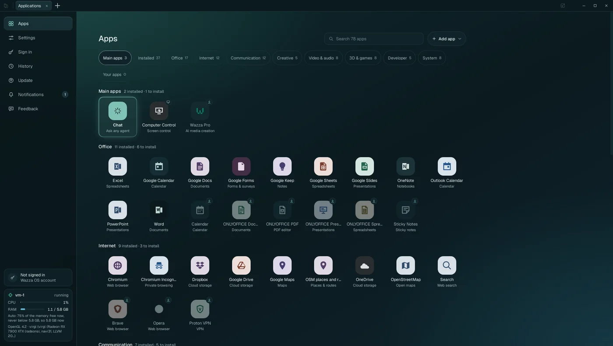
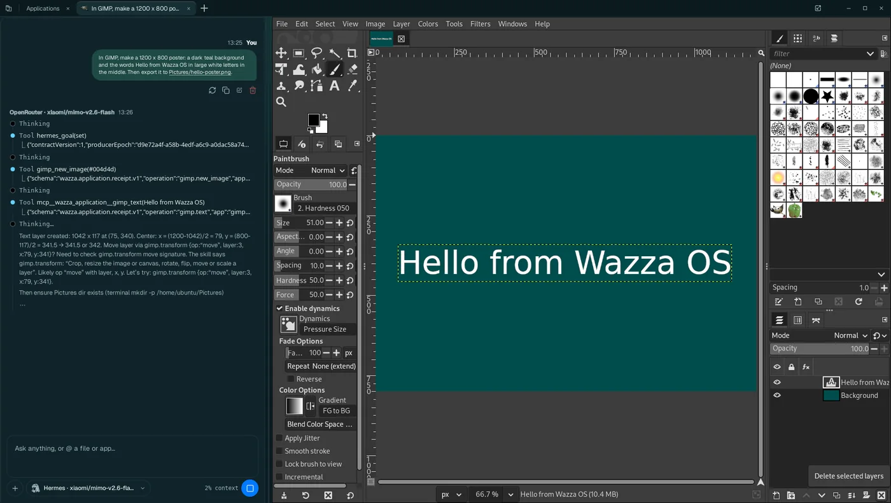

# Wazza OS user guide

- The Wazza OS website: **<https://os.wazza.ai/>**
- **[Download Wazza OS](https://os.wazza.ai/download)** for Linux. During the beta, the download page asks for the access
  code you received.
- **[Sign in to your Wazza account (Wazza OS, Wazza Pro)](https://app.wazza.ai/auth/login)**

Read the guide: **<https://os-guide.wazza.ai/>**

<table>
  <tr>
    <td width="50%"><a href="https://os-guide.wazza.ai/apps.html"></a></td>
    <td width="50%"><a href="https://os-guide.wazza.ai/chats.html"></a></td>
  </tr>
  <tr>
    <td><a href="https://os-guide.wazza.ai/apps.html"><b>The Applications tab</b></a>: every app, ready to install in one click.</td>
    <td><a href="https://os-guide.wazza.ai/chats.html"><b>A tab at work</b></a>: the app on the right, its Chat doing your request on the left.</td>
  </tr>
</table>

Wazza OS is AI that works with you, in the tools you already use. It runs a computer of its own (a virtual machine)
next to yours, with real desktop apps in it, and AI agents that work in those apps beside you: you ask, they work,
you watch, step in, or carry on in your own tab.

- **Real apps, safely apart.** GIMP, Blender, ONLYOFFICE, a browser, VSCodium and dozens more run in virtual machines,
  not on your computer.
- **Several agents at once.** Each app opens in a tab with its own Chat; agents work in parallel tabs while you keep
  yours.
- **Skills and personas.** Agents load know-how for each app and task, and learn your way of working.
- **Drive.** Agents see the app's screen and use the mouse and keyboard, in any app.
- **Any AI.** A plan you already pay for, an API key from one of 73 providers, a company gateway, or a model on your
  own computer.


## Install

Paste this in a terminal, on the Linux computer where Wazza OS will live. It asks for your password once, for `sudo`.

```sh
curl -fsSL https://os.wazza.ai/install.sh | sh
```

To test first, without installing anything:

```sh
curl -fsSL https://os.wazza.ai/install.sh | sh -s -- --check
```

- **Finds your package type.** Debian, Ubuntu and their family get the `.deb`. Fedora and openSUSE get the `.rpm`. Arch
  and its family get the Arch package. Any other distribution gets the tarball.
- **Verifies the release.** Nothing installs unless the release manifest carries Wazza's Ed25519 signature and the
  package matches its signed SHA-256 and size.
- **Resumes if cut.** The package is large. If the download stops, run the command again: it continues where it
  stopped.

What your computer needs, other ways to install, updates and removal: [Install, update, remove](https://os-guide.wazza.ai/install.html).

## Connect your AI agent

Claude Code, Codex, Cursor, VS Code, Gemini CLI, Hermes and Prime Agent can work in Wazza OS through `wazza-os mcp`, the
MCP server that comes with it. For Claude Code, once:

```sh
claude mcp add --scope user wazza-os -- wazza-os mcp
```

The line for each agent: [The Wazza OS MCP](https://os-guide.wazza.ai/mcp.html#connect-an-agent-from-outside). Everything an agent can do:
[Every Wazza OS MCP tool](https://os-guide.wazza.ai/mcp-tools.html).

## Control Wazza OS

- **From a terminal**, on your desktop or on a server: [The command line](https://os-guide.wazza.ai/cli.html) and
  [Wazza OS on a server](https://os-guide.wazza.ai/cli-server.html).
- **From an agent**: [The Wazza OS MCP](https://os-guide.wazza.ai/mcp.html) and [Every Wazza OS MCP tool](https://os-guide.wazza.ai/mcp-tools.html).
- **For a language model**: the guide's index, <https://os-guide.wazza.ai/llms.txt>, and its full text in one file,
  <https://os-guide.wazza.ai/llms-full.txt>.

## Contents

- **Start here**
  - [Wazza OS: download, install, connect](https://os-guide.wazza.ai/index.html)
  - [Quick start](https://os-guide.wazza.ai/quick-start.html)
  - [Install, update, remove](https://os-guide.wazza.ai/install.html)
  - [The first start](https://os-guide.wazza.ai/first-start.html)
  - [Getting around](https://os-guide.wazza.ai/window.html)
- **Work with agents**
  - [Chats, agents and models](https://os-guide.wazza.ai/chats.html)
  - [Several agents at once](https://os-guide.wazza.ai/parallel-tabs.html)
  - [Sign in, plans and API keys](https://os-guide.wazza.ai/signin.html)
  - [Drive: agents on screen](https://os-guide.wazza.ai/drive.html)
  - [Computer Control](https://os-guide.wazza.ai/computer-control.html)
  - [Skills, learning and personas](https://os-guide.wazza.ai/skills.html)
- **Apps and files**
  - [Apps and tabs](https://os-guide.wazza.ai/apps.html)
  - [Desktop apps and the GPU](https://os-guide.wazza.ai/gpu-apps.html)
  - [Add your own apps](https://os-guide.wazza.ai/custom-apps.html)
  - [Files and sharing](https://os-guide.wazza.ai/files.html)
  - [Move files](https://os-guide.wazza.ai/files-move.html)
- **Connect and automate**
  - [The Wazza OS MCP](https://os-guide.wazza.ai/mcp.html)
  - [Every MCP tool](https://os-guide.wazza.ai/mcp-tools.html)
  - [The command line](https://os-guide.wazza.ai/cli.html)
  - [On a server (virtual screen)](https://os-guide.wazza.ai/cli-server.html)
- **Settings**
  - [General](https://os-guide.wazza.ai/settings-general.html)
  - [Virtual machines](https://os-guide.wazza.ai/settings-vms.html)
  - [VM resources](https://os-guide.wazza.ai/settings-resources.html)
  - [Chats & agents](https://os-guide.wazza.ai/settings-chats.html)
  - [Skills & learning](https://os-guide.wazza.ai/settings-skills.html)
  - [Files & sharing](https://os-guide.wazza.ai/settings-files.html)
  - [Sync & team](https://os-guide.wazza.ai/settings-sync.html)
  - [This computer](https://os-guide.wazza.ai/settings-computer.html)
  - [The Update page](https://os-guide.wazza.ai/update.html)
- **How it behaves**
  - [Privacy and security](https://os-guide.wazza.ai/privacy-security.html)
  - [Memory, CPU and disk](https://os-guide.wazza.ai/memory-cpu.html)
- **Help**
  - [Troubleshooting](https://os-guide.wazza.ai/troubleshooting.html)
  - [Glossary](https://os-guide.wazza.ai/glossary.html)

## About this repository

This repository is the published Wazza OS user guide, a static site served by GitHub Pages. It holds no source code
of Wazza OS. Its pages are generated from the guide's source and published as they are: please send corrections
through the Feedback page of Wazza OS (Home › Feedback) rather than as changes here.

## License

The user guide (its text and pictures) is licensed under the [Apache License 2.0](LICENSE). The Geist font in
`assets/fonts/` is licensed under the SIL Open Font License 1.1 (see `assets/fonts/README.md`).
